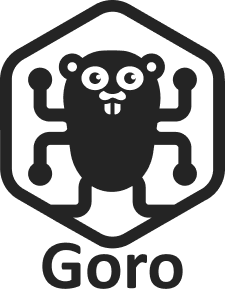

<p align="center">
    <picture>
      <source media="(prefers-color-scheme: dark)" srcset="assets/img/goro.logo-dark.png">
      <source media="(prefers-color-scheme: light)" srcset="assets/img/goro.logo.png">
      
    </picture>
</p>

[](https://t.me/gorohub)

GORO is a tool that creates a neat and easily expandable project layout for your Golang code, including all the essential boilerplate.

## Project Status

⚠️ **Alpha Stage: Work in Progress**

This project is currently in the alpha stage, indicating that it's in the early phases of development. It may contain bugs, undergo frequent changes, and lack certain features. Use it cautiously and feel free to contribute to its improvement. Check the issues for known problems or planned enhancements.

## Why use GORO?

Starting a new Golang project often involves setting up a project layout and defining a solid architecture. GORO, the code generation tool, simplifies this process, allowing you to focus on the core of your project rather than getting bogged down by the initial setup.

### Key Benefits:

- **Rapid Project Kickstart:**
  GORO provides a clean and easily extendable Golang project layout, enabling you to kickstart your project swiftly. Say goodbye to the tedious task of manually structuring your project each time.

- **Consistent Code Architecture:**
  With GORO, maintain a single, consistent approach to your code architecture across projects. This ensures a streamlined development process and facilitates easier collaboration among team members.

- **Time Savings:**
  GORO saves you valuable time by automating the project initialization process. The time spent on setting up a new project with GORO is significantly less than manual implementation, allowing you to dive into your project's core functionalities sooner.

- **Reduced Error Rate:**
  GORO minimizes the chances of errors during project setup. By automating the generation of a clean and organized project structure, GORO reduces the risk of common mistakes, letting you focus on the creative and innovative aspects of your project.

- **Flexibility with Frameworks:**
  GORO is designed to integrate seamlessly with various web frameworks. Whether you prefer a specific framework or want the flexibility to switch between them, GORO provides the adaptability you need.

Give GORO a try and experience a faster, more efficient start to your Golang projects.

## Getting started
GORO needs Go 1.26 or newer. To install it, run:
```bash
go install github.com/hanagantig/goro@latest
```

## Run an example service
Goro uses yaml configuration for your service modules.
Download an example config [goro.yaml](https://github.com/hanagantig/goro/blob/main/example/testapp/goro.yaml).

After that you can run `init` command with the config:
```bash
goro init --config /path/to/config/goro.yaml
```
You will be prompted for the workir directory. Provide an absolute path for your service root path.

**Voilà!** Your service is ready. You can run and check the `ping` http method generated by default.
Go to your workdir and run command:
```bash
go run . http --config=./config/app.conf.yaml
```

Open in your browser [http://localhost:8095/api/v1/ping](http://localhost:8095/api/v1/ping)
And you can see `pong` for your `ping`.

`init` only starts a new service: it refuses a directory that already holds a goro project and
points you to `update`.

## Updating your service
Edit `goro.yaml`, then run `update` with it:
```bash
goro update --config /path/to/config/goro.yaml
```
To see first what `update` would do, with a diff for every file it would regenerate, add
`--dry-run`. It writes nothing.

### What goro regenerates
goro decides per file who owns it.

- **goro owns** the files that start with the marker line
  `// Code generated by goro. DO NOT EDIT.`:
  - `internal/app/*.go`;
  - `internal/usecase/usecase.go`;
  - `internal/service/<service>/service.go` and `internal/service/transactor.go`;
  - `internal/adapter/<storage>repo/<adapter>/repository.go` and
    `internal/adapter/<storage>repo/transactor.go`.

  `update` regenerates them on every run, so edits in them are lost. `usecase.go` and
  `service.go` hold only the struct and its constructor. The older header
  `// Code generated by goro; DO NOT EDIT.`, which `internal/app` files made by older goro
  versions carry, counts as the marker too.
- **You own** every other file: method files, `dep_*.go` files, handlers, config, `cmd/`,
  `main.go` and `pkg/`. goro creates them once when they are missing and never changes them again.

Each dependency of the use case or of a service has its own `dep_<dependency>.go` file, named
after the dependency in `goro.yaml` (`MyRepo` becomes `dep_my_repo.go`). It holds the interface
that the struct uses for that dependency; add the methods you call. The interface of a
transactional adapter embeds `service.Transactor`.

### Taking ownership of a generated file
To keep your own version of a file goro owns, delete its marker line. `update` then leaves the
file alone and warns about it as `skip-unmarked`. For a `usecase.go` or `service.go`, goro also
stops creating `dep_*.go` files next to it, because your file may declare those interfaces
itself. Put the marker line back to hand the file back to goro.

### Orphans
`update` deletes nothing. It lists as `orphan` the code in goro's folders that `goro.yaml`
doesn't describe:
- Go files in `internal/usecase/` that goro doesn't generate for the listed methods and
  dependencies;
- packages in `internal/service/` and `internal/adapter/` that `goro.yaml` doesn't list, and
  storage folders in `internal/adapter/` without any listed adapter;
- Go files in listed service and adapter packages that goro doesn't generate for their methods
  and dependencies.

Test files and non-Go files don't count. goro leaves orphans alone, and the generated wiring
doesn't use them. Some are your own helpers, such as `internal/usecase/errors.go`; others are
left over from a method, service, adapter or dependency you removed from `goro.yaml`. Delete
the leftovers.

### Actions
`update` prints one line per file it acts on:

| Action | Meaning |
| --- | --- |
| `create` | The file is missing; goro writes it. |
| `overwrite` | A file goro owns whose content changes; goro rewrites it. |
| `unchanged` | A file goro owns that is up to date; not printed. |
| `skip` | A file you own; goro leaves it alone. Only `--dry-run` lists these. |
| `skip-unmarked` | A file at a path goro generates, without the marker; it is yours, and goro leaves it alone. |
| `orphan` | Code in goro's folders that `goro.yaml` doesn't describe; goro leaves it alone. |

## Upgrading a project made by an older goro
Older goro versions put the dependency interfaces into `usecase.go` and `service.go`, and didn't
mark those files, `repository.go` or the `transactor.go` files as generated. The current goro
treats them as yours and skips them, so their constructors stop following `goro.yaml`.

The current goro does regenerate `internal/app/*.go`, because their old header counts as the
marker. Older versions rewrote only `container.go` there, so edits you made in `app.go`,
`database.go`, `http.go` or `logger.go` are lost on the first `update`, unless you delete the
marker line in those files first.

To move to the current layout once:

1. Commit your work, so that you can review and undo what goro changes.
2. Run `goro update --dry-run` and review every `overwrite` and its diff. If a diff removes code
   of yours from an `internal/app` file, delete that file's marker line to keep the file as yours.
3. Check each old `internal/service/<service>/service.go` for changes other than the
   interfaces, such as extra struct fields or constructor code. The new `service.go` holds only
   what `goro.yaml` describes, so move those changes into your own files first. If a change
   can't move, keep that `service.go` as it is and skip it in the next two steps: without the
   marker it stays yours, and goro creates no `dep_*.go` files next to it.
4. Move each interface out of `internal/usecase/usecase.go` and every other old `service.go` into
   its own `dep_<dependency>.go` file in the same package, with the imports it needs. For example,
   the `myRepo` interface in `internal/service/myservice/service.go` goes to
   `internal/service/myservice/dep_my_repo.go`.
5. Delete those old `usecase.go` and `service.go` files. Also delete the old `repository.go` and
   `transactor.go` files under `internal/service/` and `internal/adapter/`, unless you edited
   them.
6. Run `goro update --dry-run` again to check the plan, then `goro update`. goro writes the
   deleted files again with the marker and keeps your `dep_*.go` files.

## Youtube presentation

You can get more details from the Youtube video (in Russian):

[](https://www.youtube.com/watch?v=hDwqFRUuykQ)

You can also access the slides from the video through [this link](https://docs.google.com/presentation/d/1mDeRz5Sym0MiFYAVWd7Qen3sgVkGWnxR_PQ0bbDzEzo/edit?usp=sharing) from the video

# Layout


```
├── api - your api specs (swagger, protobuf etc.)
│   ├── v1 - version and particular specs inside
│   │   └── swagger.yaml
│   │
├── build - folder with docker files, docker-compose files and so on
│   ├── Dockerfile
│   └── ...
├── cmd  - folder with commands provided by your service
│   ├── command_name.go - service command implementation
│   └── ...
├── configs - service config files
│   ├── prod.conf.yaml
│   ├── local.conf.yaml
│   └── dev.conf.yaml
│
├── internal - folder for your internal package. Usually you write code here.
│   ├── app - App structure with bootstrapping, definitions and DI
│   │
│   ├── entity - service entity (they should be used globally through all layers as a data transmitters)
│   │
│   ├── service - list of our services with business logic. This layer interacts with adapter layer.
│   │
│   ├── usecase - usecase layer represent our service behaviour. It's describes all app features - interface for whole service.
│   │                 Use case orchestrate with services and aggregate service methods calls. It can be used only in handler layer.
│   ├── adapter - your infrastructure is here. Adapter folder contains packages for database connection, other http/grpc service clients, AMQP connections etc. ...
│   │   ├── webapi
│   │   ├── sqlrepository
│   │   └── ...
│   ├── config - you can find here a code for parsing and loading service configs
│   └── handler - our handlers - a layer to communicate with client. It describes our transport and request/response models.
│       ├── http - http protocol handler
│       │   ├── http.go - http server implementation
│       │   ├── router.go - base router implementation
│       │   └── api - package for service http API methods
│       │       └── v1
│       │           └── models - request/response methods (usually generated from swagger file)
│       │               ├── handler.go - api methods implementation
│       │               └── router.go  - api methods routing
│       ├── grpc - grpc protocol handlers
│       ├── amqp - amqp protocol handlers
│       └── ...
└── pkg - your public pkgs
```

## Connect with Us

Stay updated and join our community on Telegram:

[](https://t.me/gorohub)

We value your feedback, comments, and suggestions! Feel free to share your thoughts in our Telegram channel. Whether you have questions, ideas for improvement, or just want to say hello, we'd love to hear from you.
